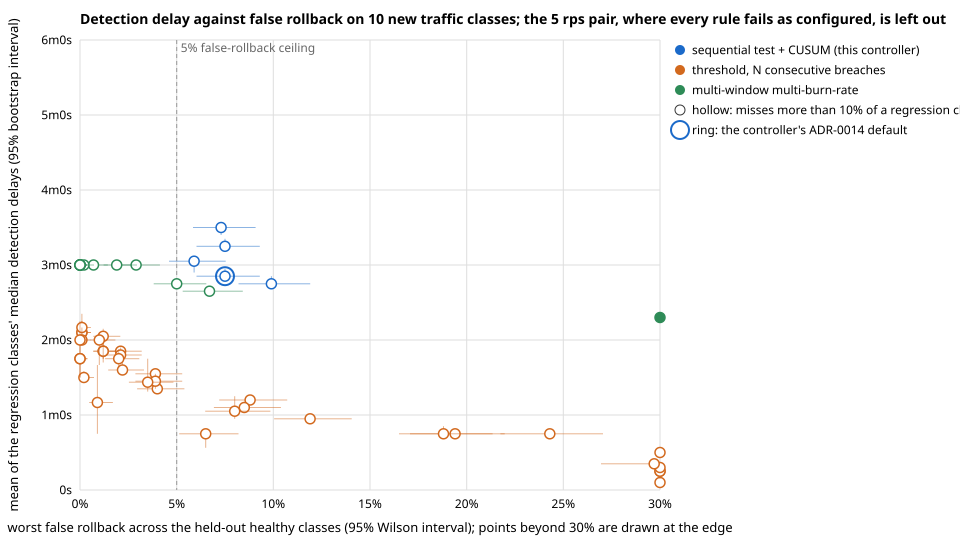

# Metrics: Baseline, Target, and Validation

Every subsystem is measured against a named baseline, not in isolation. **Baseline** is the status-quo alternative or the naive default this subsystem replaces. **Target** is what must be demonstrated before the phase counts as done. **Method** is exactly how it's measured, so the number is reproducible, not asserted.

## Why this matters

Without a platform layer, teams get infrastructure through a ticket to a platform engineer (hours to days per request) or raw Terraform written by the requesting developer. Platform engineering research consistently notes that one platform engineer can eliminate infrastructure bottlenecks for roughly fifty application developers, but only if the bottleneck-elimination is automated, not handled ticket-by-ticket. Compliance reconstruction today is a multi-day manual effort across scattered logs. Resilience gaps are typically discovered during real incidents, not before them. Every row below exists to remove one of these named costs.

## Baseline vs. target

| Subsystem | Baseline (status quo) | Target | Measurement method |
|---|---|---|---|
| Operator | Ticket-based manual provisioning: hours to days per request. | Standard-tier database reaches `Ready` in under 5 minutes end to end, zero data loss across concurrent scale/backup collisions. | The reconciler emits the histogram `kiln_tenantdatabase_time_to_ready_seconds` (CR creation to first `Ready`) on the manager's metrics endpoint, scraped by pod annotation. Run N=50 concurrent requests in CI, report p50/p95. Run the concurrency collision test suite to confirm zero data loss. |
| Provisioning/GitOps | Manual Terraform PR with human review: hours to a day before merge and apply. | Policy-compliant requests flow from submission to applied infrastructure with zero manual intervention. | Track event timestamps for `submitted`, `policy-checked`, `applied-in-ArgoCD`. Report the full latency distribution across a batch of synthetic requests. |
| Scheduler | Default kube-scheduler bin packing on a fixed synthetic workload trace, known cluster cost in $/hr. | Measurable % cost reduction on the identical workload trace, zero latency-class placements on preemptible capacity. | Replay the identical workload trace through the default scheduler and the custom plugin on equivalent node pools. Compare actual instance-hours billed, where a node bills its hourly cost for every interval in which it hosts at least one trace pod (node-occupancy hours, read from the API server's pod bindings and container run times, standing in for an autoscaler removing empty nodes); log any placement that violates a declared latency-class constraint. |
| Progressive delivery | Manual on-call detection of a bad deploy (minutes to tens of minutes), manual rollback. | Automatic detection and rollback within a bounded window of regression onset; false-rollback ceiling of 5% (alpha, ADR-0014) on healthy-but-noisy canaries and a miss ceiling of 10% (beta) at twice the configured limit. | Injected synthetic regression suite covering real regressions and injected-noise scenarios: the seeded simulation classes in `delivery-controller/internal/analysis` (1000 rollouts each) report false-rollback and miss rates and decision latency per class, and the kind end-to-end run reports rollback latency from the first traffic split and promotion latency, both read from the VirtualService and the pods rather than the CR. |
| Chaos/resilience | Zero pre-production resilience coverage; failure modes discovered during real incidents. | Defined fault taxonomy (pod-kill, network partition, latency injection, resource exhaustion) covered by automated pre-production experiments, 100% of experiments respect the declared blast radius, and every SLO breach auto-aborts with the fault removed within a bounded window. | `TestPhase5Chaos` runs the full taxonomy against a test service. Blast-radius adherence is read from the node (the `iptables` chain appears only inside targeted pods' network namespaces). Abort-trigger accuracy is measured against a forced breach (2000 ms latency vs a 1000 ms p99 limit); the abort bound is that every injected fault is gone within 30 s of the first breached window being visible in Prometheus, verified from the node (the `tc netem` qdisc cleared), and with a 15 s scrape and a 5 s poll the observed clearance runs to roughly 45 s. |
| Audit/RBAC | Manual compliance log reconstruction across disparate systems, commonly a multi-day effort at audit time. | Actor/resource/time-range audit query returns complete results in under 1 second; zero undetected tampering; zero duplicate entries under Kafka redelivery. | Load-test the query endpoint. Run a tamper-injection suite that intentionally corrupts stored hashes and confirm detection. Run a Kafka redelivery simulation and confirm duplicates are caught by the idempotency constraint, not silently double-written. |

## Validation plan

Passing the per-subsystem targets above proves each piece works in isolation. It doesn't prove the platform solves the problem end to end. This experiment closes that gap.

1. **Synthetic team simulation.** Simulate a team of 10 developer identities submitting a realistic mix of requests over a simulated week: database provisioning, scaling events, deployments, and on-demand chaos tests, at a request rate consistent with the baseline research above.
2. **Instrument everything through the audit trail.** Every simulated action must produce a real event in the Audit/RBAC service, no exceptions. This is both a load test for that subsystem and the source of truth for the comparison below.
3. **Before/after comparison.** For each request type, report the platform's measured latency and error rate against the baseline figures above, not against an arbitrary internal target. The deliverable is a single comparison table: status quo time and failure mode, versus platform time and failure mode, per request type.
4. **Failure injection during the simulation.** At least one policy violation, one bad deploy, and one forced SLO breach must be injected during the simulated week, to prove the guardrails (policy denial, auto-rollback, auto-abort) actually fire under realistic conditions, not only in isolated unit tests.

The output of this plan is also the Phase 7 demo script (see [`ROADMAP.md`](ROADMAP.md)): a single end-to-end walkthrough plus the before/after comparison table. This is the artifact that answers "how do you know it actually works" and "how do you know it's better than what people do today."

## A note on baseline figures

Baselines cited from external platform-engineering research (not measured on a real org) are stated as approximations, not internal measurements. The relative improvement claimed by each target still holds even if the absolute baseline shifts, since the comparison is against the measurement method, not a single external number.

## Service level objectives

The targets above are exit criteria: thresholds a phase had to clear once. An SLO is a promise kept over a window, with a budget for breaking it. The objectives below are proposed from the validation evidence, not yet monitored over a real window; each names its indicator's source so that the first real window can be measured the same way the validation was. The policy is the usual one: a subsystem whose budget is spent in the window takes no feature change until the budget is back, and the exhaustion is a postmortem.

| Objective | Indicator (source) | Window and budget | Evidence so far |
|---|---|---|---|
| 95% of standard Postgres claims reach `Ready` within 60 s of the request being accepted | `PROVISION_REQUEST` to `PROVISION Ready` audit rows, equivalently the `kiln_tenantdatabase_time_to_ready_seconds` histogram | 28 days; 5% of claims | p95 16 s, n=10, plus the traced claim at 6.94 s (validation results below) |
| 100% of claims that violate an org rule are denied before anything is composed | `POLICY_DENY` rows versus objects on the cluster | an invariant, no budget: a single miss is an incident | 1/1 denied in the simulated week, every violation class denied in `TestPhase2` |
| A regression of at least twice the error-rate limit is rolled back within 3 minutes of its onset in 90% of rollouts | `DEPLOY Started` to `ROLLBACK` rows, paired by template hash, against the onset in the canary's own metrics | 28 days; 10% of real regressions | simulation p95 2m30s for the 2x step, 0 of 1000 missed; the one injected 30% regression on the cluster rolled back in 50 s |
| No more than 5% of healthy rollouts are rolled back | `ROLLBACK` rows whose canary never breached its limits over a window, judged after the fact from Prometheus | 28 days; 5% of healthy rollouts | simulation worst class 2.8%; 0 of 29 healthy deploys rolled back on the cluster |
| A chaos experiment that breaches its SLO has every fault removed from the node within 60 s of the breach | `CHAOS_EXPERIMENT Aborted` row and the `iptables`/`tc` state on the node | an invariant, no budget | abort 25 s after the fault went live, rule gone 1 s after the row |
| 99% of audit queries over an actor and time range return within 1 s with the same count `psql` gives | client round trip of `GET /v1/audit` and the psql cross-check | 28 days; 1% of queries | p95 108 ms, n=10, every count matching |
| Every audited transition has exactly one audit row | informer-observed transitions versus rows, and the chain verification | an invariant, no budget | proven for the simulated week (201 rows, 0 publish failures); the under-crash proof (Phase 8) passed in CI run [38176386056](https://github.com/trnahnh/kiln/actions/runs/38176386056) on 2026-10-11 on commit `24d3932`, after a harness bug had kept it red for 29 days, see `docs/postmortems/2026-10-10-nightly-red-for-29-days.md` |

## Detector comparison

The canary decision ([ADR-0014](decisions/0014-sequential-probability-ratio-test-decides-rollback.md)) against the two rules a canary controller usually ships with, on the simulation suite's traffic models and seeds (method in [`TESTING.md`](TESTING.md#progressive-delivery-controller)): a per-window threshold that rolls back after N consecutive breaches, the shape of Flagger's and Argo Rollouts' metric checks, and a multi-window multi-burn-rate alert on the error budget, the shape of the SRE Workbook's alerting chapter. The alternatives are tuned in-sample on these classes, the sequential test is not; both alternatives drive a fixed schedule of four one-minute steps. Produced by `go test ./internal/analysis -run TestDetectorComparison` in `delivery-controller/` on 2026-10-10, verbatim:

| Detector | Tuning | Worst false rollback (healthy/noisy) | step to 30%: detect p50 / p95, missed | step to 2% (the H1 rate): detect p50 / p95, missed | ramp 0.5% to 3% over 8 windows: detect p50 / p95, missed | latency tail 5%: detect p50 / p95, missed |
|---|---|---|---|---|---|---|
| sequential test + CUSUM (this controller) | ADR-0014 defaults | 2.8% | 30s / 30s, 0.0% | 1m15s / 2m30s, 0.0% | 1m45s / 2m0s, 0.0% | 30s / 45s, 0.0% |
| threshold, N consecutive breaches | limit x1.5, 4 consecutive | 2.0% | 45s / 45s, 0.0% | 1m15s / 2m45s, 6.6% | 1m45s / 2m30s, 0.0% | 45s / 45s, 0.0% |
| multi-window multi-burn-rate | burn x1.25 (18.0/7.5/1.2) | 1.8% | 15s / 15s, 0.0% | 3m0s / 3m0s, 2.0% | 3m0s / 3m0s, 0.0% | 3m0s / 3m0s, 0.0% |

Per-class false rollback for each row (for a regression class, rollbacks before its onset):

| Detector | Tuning | healthy clean | healthy half of the limit | noisy steady at 90% of the limit | noisy bursty, long-run 80% of the limit | noisy one window at 10x the limit | step to 30% | step to 2% (the H1 rate) | ramp 0.5% to 3% over 8 windows | latency tail 5% |
|---|---|---|---|---|---|---|---|---|---|---|
| sequential test + CUSUM (this controller) | ADR-0014 defaults | 0.0% | 0.0% | 0.4% | 2.8% | 0.0% | 0.0% | 0.0% | 0.0% | 0.0% |
| threshold, N consecutive breaches | limit x1.5, 4 consecutive | 0.0% | 0.0% | 2.0% | 0.8% | 0.0% | 0.0% | 0.0% | 0.0% | 0.0% |
| multi-window multi-burn-rate | burn x1.25 (18.0/7.5/1.2) | 0.0% | 0.0% | 0.0% | 1.8% | 0.0% | 0.0% | 0.0% | 0.0% | 0.0% |

**Reading the table.**

- **At equal false-rollback cost, the sequential test is the only rule that catches every regression class within the rollout.** Its worst false-rollback rate, 2.8% on bursty traffic, is the ceiling the others are tuned to. The consecutive-breach threshold tuned to 2.0% matches it on the subtle 2x step at the median (1m15s) but misses 6.6% of those rollouts and is 15 s slower on the flagrant ones; the burn-rate alert tuned to 1.8% is the fastest on the flagrant step (15 s, one window) and the slowest on everything subtle (3 minutes, its longest window), because a 2x regression is a 2x burn and only its 1x window can see it.
- **The sweep shows why.** For the threshold rule, each step of N trades false rollbacks for misses at the limit: N=3 gives 8.0% false rollbacks, N=4 2.0% with 6.6% missed, N=5 0.1% with 18.9% missed. For the burn-rate rule the scale factor does the same: 1.0x gives 16.2% false rollbacks, 1.25x 1.8% with 2.0% missed, 1.5x 0.3% with 9.0% missed, 2x misses 80%. Neither rule has an operating point that is both under the ceiling and complete, because a fixed-window rule cannot accumulate evidence across windows; the CUSUM can. (`KILN_COMPARISON_SWEEP=1` logs every point.)
- **What this does not show.** All three rules see the same synthetic traffic: independent requests at a fixed rate with Bernoulli failures, bursty only in the one class that draws each window's rate from a Beta distribution. Real traffic has diurnal rate, correlated failures and retries; the burn-rate alert's long windows are a strength against those that this model cannot credit. The comparison is of the decision rules, not of the products that ship them.

### Held-out evaluation on traffic the rules were not tuned on

The comparison above tuned the alternatives on the classes it scored them on. `TestDetectorHoldout` (method in [`TESTING.md`](TESTING.md#progressive-delivery-controller)) widens the pool to 21 classes, twelve of them new, splits it into two stratified halves, tunes each alternative on one half and scores it on the other, both ways round, and scores the sequential test untuned. Produced by `KILN_HOLDOUT_REPORT=holdout.md KILN_HOLDOUT_SVG=docs/assets/detector-tradeoff.svg go test ./internal/analysis -run TestDetectorHoldout -count=1` in `delivery-controller/` on 2026-10-11, verbatim.

Classes: 21, of which 9 from round 1 and 12 new. Fold A holds healthy half of the limit; noisy one window at 10x the limit; step to 30%; step to 2% (the H1 rate); ramp 0.5% to 3% over 8 windows; latency tail 5%; diurnal, rollout starts in the trough, errors track load; diurnal, rollout starts at the peak, errors track load; low traffic, 20 rps at 0.5%; very low traffic, 5 rps at 0.5%; heavy-tailed latency, mean 0.5% to 2%; fold B holds healthy clean; noisy steady at 90% of the limit; noisy bursty, long-run 80% of the limit; retry storms, rare bursts at 5x the limit with 1.5x retry volume; heavy-tailed latency, mean 0.5%; diurnal, step to 2% x load from the trough; diurnal, step to 2% x load from the peak; retry storm from onset, bursts at 8% half the time; low traffic, 20 rps, step to 3%; very low traffic, 5 rps, step to 5%.

#### all classes

#### Fold A: tuned on fold A, scored on fold B

| Detector | Tuning chosen on the other half | Under both ceilings there? | Worst false rollback (held out) | Worst miss (held out) | Mean of median delays (held out) | diurnal, step to 2% x load from the trough: p50, missed | diurnal, step to 2% x load from the peak: p50, missed | retry storm from onset, bursts at 8% half the time: p50, missed | low traffic, 20 rps, step to 3%: p50, missed | very low traffic, 5 rps, step to 5%: p50, missed |
|---|---|---|---|---|---|---|---|---|---|---|
| sequential test + CUSUM (this controller) | alpha 0.05 (ADR-0014 default) | no, nearest false-rollback rate | 7.5% (6.0 to 9.3) | 4.1% | 4m9s (4m6s to 4m18s) | 5m0s, 0.0% | 45s, 0.0% | 1m0s, 4.1% | 5m0s, 0.0% | 9m0s, 0.0% |
| threshold, N consecutive breaches | limit x1.0, 1 consecutive | no, nearest false-rollback rate | 100.0% (99.6 to 100.0) | 59.8% | 9s (9s to 9s) | 15s, 19.6% | 0s, 59.8% | 0s, 38.2% | 15s, 27.0% | 15s, 8.4% |
| multi-window multi-burn-rate | burn x0.50 (7.2/3.0/0.5) | no, nearest false-rollback rate | 99.8% (99.3 to 99.9) | 0.7% | 1m54s (1m54s to 1m57s) | 3m0s, 0.0% | 3m0s, 0.0% | 1m0s, 0.7% | 1m30s, 0.0% | 1m0s, 0.0% |

False rollback per held-out healthy class:

| Detector | healthy clean | noisy steady at 90% of the limit | noisy bursty, long-run 80% of the limit | retry storms, rare bursts at 5x the limit with 1.5x retry volume | heavy-tailed latency, mean 0.5% |
|---|---|---|---|---|---|
| sequential test + CUSUM (this controller), alpha 0.05 (ADR-0014 default) | 0.0% | 0.4% | 2.8% | 7.5% | 0.0% |
| threshold, N consecutive breaches, limit x1.0, 1 consecutive | 9.6% | 100.0% | 99.8% | 64.6% | 92.3% |
| multi-window multi-burn-rate, burn x0.50 (7.2/3.0/0.5) | 0.0% | 99.8% | 57.0% | 12.0% | 22.8% |

#### Fold B: tuned on fold B, scored on fold A

| Detector | Tuning chosen on the other half | Under both ceilings there? | Worst false rollback (held out) | Worst miss (held out) | Mean of median delays (held out) | step to 30%: p50, missed | step to 2% (the H1 rate): p50, missed | ramp 0.5% to 3% over 8 windows: p50, missed | latency tail 5%: p50, missed | heavy-tailed latency, mean 0.5% to 2%: p50, missed |
|---|---|---|---|---|---|---|---|---|---|---|
| sequential test + CUSUM (this controller) | alpha 0.05 (ADR-0014 default) | no, nearest false-rollback rate | 99.3% (98.6 to 99.7) | 27.9% | 1m18s (1m15s to 1m21s) | 30s, 0.0% | 1m15s, 0.0% | 1m45s, 0.0% | 30s, 0.0% | 2m30s, 27.9% |
| threshold, N consecutive breaches | limit x1.0, 8 consecutive | no, nearest false-rollback rate | 0.0% (0.0 to 0.4) | 97.0% | 2m0s (1m57s to 2m6s) | 1m45s, 0.0% | 1m45s, 5.0% | 2m30s, 1.0% | 1m45s, 0.0% | 2m15s, 97.0% |
| multi-window multi-burn-rate | burn x1.25 (18.0/7.5/1.2) | no, nearest false-rollback rate | 1.5% (0.9 to 2.5) | 42.4% | 2m27s (2m27s to 2m27s) | 15s, 0.0% | 3m0s, 2.0% | 3m0s, 0.0% | 3m0s, 0.0% | 3m0s, 42.4% |

False rollback per held-out healthy class:

| Detector | healthy half of the limit | noisy one window at 10x the limit | diurnal, rollout starts in the trough, errors track load | diurnal, rollout starts at the peak, errors track load | low traffic, 20 rps at 0.5% | very low traffic, 5 rps at 0.5% |
|---|---|---|---|---|---|---|
| sequential test + CUSUM (this controller), alpha 0.05 (ADR-0014 default) | 0.0% | 0.0% | 0.0% | 0.0% | 0.0% | 99.3% |
| threshold, N consecutive breaches, limit x1.0, 8 consecutive | 0.0% | 0.0% | 0.0% | 0.0% | 0.0% | 0.0% |
| multi-window multi-burn-rate, burn x1.25 (18.0/7.5/1.2) | 0.0% | 0.0% | 0.0% | 0.0% | 0.0% | 1.5% |

#### Where the sequential test loses

- fold B, step to 30%: p50 30s against 15s for multi-window multi-burn-rate (burn x1.25 (18.0/7.5/1.2)), both catching 100.0% or more
- fold B, very low traffic, 5 rps at 0.5%: 99.3% false rollback against 0.0% for threshold, N consecutive breaches (limit x1.0, 8 consecutive)
- fold B, very low traffic, 5 rps at 0.5%: 99.3% false rollback against 1.5% for multi-window multi-burn-rate (burn x1.25 (18.0/7.5/1.2))
- fold B, very low traffic, 5 rps at 0.5%: the sequential test itself rolls back 99.3% of healthy rollouts (Inconclusive 993)

#### without the very-low-traffic pair

#### Fold A: tuned on fold A, scored on fold B

| Detector | Tuning chosen on the other half | Under both ceilings there? | Worst false rollback (held out) | Worst miss (held out) | Mean of median delays (held out) | diurnal, step to 2% x load from the trough: p50, missed | diurnal, step to 2% x load from the peak: p50, missed | retry storm from onset, bursts at 8% half the time: p50, missed | low traffic, 20 rps, step to 3%: p50, missed |
|---|---|---|---|---|---|---|---|---|---|
| sequential test + CUSUM (this controller) | alpha 0.05 (ADR-0014 default) | no, nearest false-rollback rate | 7.5% (6.0 to 9.3) | 4.1% | 2m56.25s (2m52.5s to 3m3.75s) | 5m0s, 0.0% | 45s, 0.0% | 1m0s, 4.1% | 5m0s, 0.0% |
| threshold, N consecutive breaches | limit x1.0, 8 consecutive | no, nearest false-rollback rate | 7.0% (5.6 to 8.8) | 86.1% | 2m3.75s (2m3.75s to 2m11.25s) | 2m30s, 79.7% | 1m45s, 0.2% | 2m0s, 86.1% | 2m0s, 19.7% |
| multi-window multi-burn-rate | burn x1.25 (18.0/7.5/1.2) | no, nearest false-rollback rate | 2.9% (2.0 to 4.1) | 15.9% | 3m0s (3m0s to 3m0s) | 3m0s, 15.6% | 3m0s, 0.0% | 3m0s, 15.9% | 3m0s, 0.2% |

False rollback per held-out healthy class:

| Detector | healthy clean | noisy steady at 90% of the limit | noisy bursty, long-run 80% of the limit | retry storms, rare bursts at 5x the limit with 1.5x retry volume | heavy-tailed latency, mean 0.5% |
|---|---|---|---|---|---|
| sequential test + CUSUM (this controller), alpha 0.05 (ADR-0014 default) | 0.0% | 0.4% | 2.8% | 7.5% | 0.0% |
| threshold, N consecutive breaches, limit x1.0, 8 consecutive | 0.0% | 7.0% | 0.0% | 0.1% | 0.0% |
| multi-window multi-burn-rate, burn x1.25 (18.0/7.5/1.2) | 0.0% | 0.0% | 1.8% | 2.9% | 0.0% |

#### Fold B: tuned on fold B, scored on fold A

| Detector | Tuning chosen on the other half | Under both ceilings there? | Worst false rollback (held out) | Worst miss (held out) | Mean of median delays (held out) | step to 30%: p50, missed | step to 2% (the H1 rate): p50, missed | ramp 0.5% to 3% over 8 windows: p50, missed | latency tail 5%: p50, missed | heavy-tailed latency, mean 0.5% to 2%: p50, missed |
|---|---|---|---|---|---|---|---|---|---|---|
| sequential test + CUSUM (this controller) | alpha 0.05 (ADR-0014 default) | no, nearest false-rollback rate | 0.0% (0.0 to 0.4) | 27.9% | 1m18s (1m15s to 1m21s) | 30s, 0.0% | 1m15s, 0.0% | 1m45s, 0.0% | 30s, 0.0% | 2m30s, 27.9% |
| threshold, N consecutive breaches | limit x1.0, 8 consecutive | no, nearest false-rollback rate | 0.0% (0.0 to 0.4) | 97.0% | 2m0s (1m57s to 2m6s) | 1m45s, 0.0% | 1m45s, 5.0% | 2m30s, 1.0% | 1m45s, 0.0% | 2m15s, 97.0% |
| multi-window multi-burn-rate | burn x1.25 (18.0/7.5/1.2) | no, nearest false-rollback rate | 0.0% (0.0 to 0.4) | 42.4% | 2m27s (2m27s to 2m27s) | 15s, 0.0% | 3m0s, 2.0% | 3m0s, 0.0% | 3m0s, 0.0% | 3m0s, 42.4% |

False rollback per held-out healthy class:

| Detector | healthy half of the limit | noisy one window at 10x the limit | diurnal, rollout starts in the trough, errors track load | diurnal, rollout starts at the peak, errors track load | low traffic, 20 rps at 0.5% |
|---|---|---|---|---|---|
| sequential test + CUSUM (this controller), alpha 0.05 (ADR-0014 default) | 0.0% | 0.0% | 0.0% | 0.0% | 0.0% |
| threshold, N consecutive breaches, limit x1.0, 8 consecutive | 0.0% | 0.0% | 0.0% | 0.0% | 0.0% |
| multi-window multi-burn-rate, burn x1.25 (18.0/7.5/1.2) | 0.0% | 0.0% | 0.0% | 0.0% | 0.0% |

#### Where the sequential test loses

- fold A, noisy bursty, long-run 80% of the limit: 2.8% false rollback against 0.0% for threshold, N consecutive breaches (limit x1.0, 8 consecutive)
- fold A, noisy bursty, long-run 80% of the limit: 2.8% false rollback against 1.8% for multi-window multi-burn-rate (burn x1.25 (18.0/7.5/1.2))
- fold A, retry storms, rare bursts at 5x the limit with 1.5x retry volume: 7.5% false rollback against 0.1% for threshold, N consecutive breaches (limit x1.0, 8 consecutive)
- fold A, retry storms, rare bursts at 5x the limit with 1.5x retry volume: 7.5% false rollback against 2.9% for multi-window multi-burn-rate (burn x1.25 (18.0/7.5/1.2))
- fold B, step to 30%: p50 30s against 15s for multi-window multi-burn-rate (burn x1.25 (18.0/7.5/1.2)), both catching 100.0% or more

#### Trade-off on the ten new classes

Every tuning point of every family on the ten round-2 classes without the 5 rps pair; worst false rollback with its 95% Wilson interval, mean of the regression classes' median delays with a 95% bootstrap interval; the rows the plot draws:

| Detector | Tuning | Worst false rollback | 95% interval | Worst miss | Mean of median delays | 95% interval |
|---|---|---|---|---|---|---|
| sequential test + CUSUM (this controller) | alpha 0.01 | 7.3% | 5.8 to 9.1 | 33.2% | 3m30s | 3m24s to 3m33s |
| sequential test + CUSUM (this controller) | alpha 0.02 | 7.5% | 6.0 to 9.3 | 30.5% | 3m15s | 3m12s to 3m21s |
| sequential test + CUSUM (this controller) | alpha 0.05 (ADR-0014 default) | 7.5% | 6.0 to 9.3 | 27.9% | 2m51s | 2m48s to 3m0s |
| sequential test + CUSUM (this controller) | alpha 0.10 | 9.9% | 8.2 to 11.9 | 18.2% | 2m45s | 2m42s to 2m51s |
| sequential test + CUSUM (this controller) | alpha 0.20 | 5.9% | 4.6 to 7.5 | 22.9% | 3m3s | 2m54s to 3m6s |
| threshold, N consecutive breaches | limit x1.0, 1 consecutive | 97.4% | 96.2 to 98.2 | 59.8% | 6s | 6s to 6s |
| threshold, N consecutive breaches | limit x1.0, 2 consecutive | 46.2% | 43.1 to 49.3 | 12.3% | 30s | 27s to 33s |
| threshold, N consecutive breaches | limit x1.0, 3 consecutive | 11.9% | 10.0 to 14.1 | 22.0% | 57s | 54s to 57s |
| threshold, N consecutive breaches | limit x1.0, 4 consecutive | 4.0% | 3.0 to 5.4 | 50.6% | 1m21s | 1m18s to 1m24s |
| threshold, N consecutive breaches | limit x1.0, 5 consecutive | 2.2% | 1.5 to 3.3 | 71.4% | 1m36s | 1m33s to 1m42s |
| threshold, N consecutive breaches | limit x1.0, 6 consecutive | 1.2% | 0.7 to 2.1 | 86.5% | 1m51s | 1m45s to 1m54s |
| threshold, N consecutive breaches | limit x1.0, 8 consecutive | 0.1% | 0.0 to 0.6 | 97.0% | 2m6s | 2m3s to 2m15s |
| threshold, N consecutive breaches | limit x1.5, 1 consecutive | 86.7% | 84.5 to 88.7 | 27.0% | 15s | 9s to 15s |
| threshold, N consecutive breaches | limit x1.5, 2 consecutive | 24.3% | 21.7 to 27.1 | 18.6% | 45s | 45s to 48s |
| threshold, N consecutive breaches | limit x1.5, 3 consecutive | 8.8% | 7.2 to 10.7 | 54.3% | 1m12s | 1m9s to 1m15s |
| threshold, N consecutive breaches | limit x1.5, 4 consecutive | 3.9% | 2.9 to 5.3 | 80.9% | 1m33s | 1m27s to 1m36s |
| threshold, N consecutive breaches | limit x1.5, 5 consecutive | 2.1% | 1.4 to 3.2 | 92.6% | 1m51s | 1m39s to 1m51s |
| threshold, N consecutive breaches | limit x1.5, 6 consecutive | 1.2% | 0.7 to 2.1 | 97.3% | 1m51s | 1m45s to 2m0s |
| threshold, N consecutive breaches | limit x1.5, 8 consecutive | 0.1% | 0.0 to 0.6 | 99.6% | 2m6s | 2m3s to 2m21s |
| threshold, N consecutive breaches | limit x2.0, 1 consecutive | 55.2% | 52.1 to 58.3 | 27.0% | 15s | 12s to 15s |
| threshold, N consecutive breaches | limit x2.0, 2 consecutive | 19.4% | 17.1 to 22.0 | 63.7% | 45s | 42s to 48s |
| threshold, N consecutive breaches | limit x2.0, 3 consecutive | 8.5% | 6.9 to 10.4 | 92.7% | 1m6s | 1m3s to 1m9s |
| threshold, N consecutive breaches | limit x2.0, 4 consecutive | 3.9% | 2.9 to 5.3 | 98.6% | 1m27s | 1m21s to 1m33s |
| threshold, N consecutive breaches | limit x2.0, 5 consecutive | 2.1% | 1.4 to 3.2 | 99.9% | 1m48s | 1m45s to 1m54s |
| threshold, N consecutive breaches | limit x2.0, 6 consecutive | 1.2% | 0.7 to 2.1 | 99.9% | 2m3s | 1m45s to 2m9s |
| threshold, N consecutive breaches | limit x2.0, 8 consecutive | 0.1% | 0.0 to 0.6 | 100.0% | 2m10s | 2m5s to 2m15s |
| threshold, N consecutive breaches | limit x3.0, 1 consecutive | 44.1% | 41.1 to 47.2 | 58.5% | 18s | 15s to 21s |
| threshold, N consecutive breaches | limit x3.0, 2 consecutive | 18.8% | 16.5 to 21.3 | 95.1% | 45s | 42s to 51s |
| threshold, N consecutive breaches | limit x3.0, 3 consecutive | 8.0% | 6.5 to 9.8 | 99.4% | 1m3s | 57s to 1m15s |
| threshold, N consecutive breaches | limit x3.0, 4 consecutive | 3.5% | 2.5 to 4.8 | 100.0% | 1m26.25s | 1m18.75s to 1m41.25s |
| threshold, N consecutive breaches | limit x3.0, 5 consecutive | 2.0% | 1.3 to 3.1 | 100.0% | 1m45s | 1m37.5s to 1m52.5s |
| threshold, N consecutive breaches | limit x3.0, 6 consecutive | 1.0% | 0.5 to 1.8 | 100.0% | 2m0s | 1m40s to 2m5s |
| threshold, N consecutive breaches | limit x3.0, 8 consecutive | 0.1% | 0.0 to 0.6 | 100.0% | 2m0s | 1m55s to 2m10s |
| threshold, N consecutive breaches | limit x5.0, 1 consecutive | 29.7% | 26.9 to 32.6 | 91.3% | 21s | 18s to 21s |
| threshold, N consecutive breaches | limit x5.0, 2 consecutive | 6.5% | 5.1 to 8.2 | 100.0% | 45s | 33.75s to 52.5s |
| threshold, N consecutive breaches | limit x5.0, 3 consecutive | 0.9% | 0.5 to 1.7 | 100.0% | 1m10s | 45s to 1m40s |
| threshold, N consecutive breaches | limit x5.0, 4 consecutive | 0.2% | 0.1 to 0.7 | 100.0% | 1m30s | 1m30s to 1m35s |
| threshold, N consecutive breaches | limit x5.0, 5 consecutive | 0.0% | 0.0 to 0.4 | 100.0% | 1m45s | 1m30s to 2m0s |
| threshold, N consecutive breaches | limit x5.0, 6 consecutive | 0.0% | 0.0 to 0.4 | 100.0% | 1m45s | 1m30s to 1m45s |
| threshold, N consecutive breaches | limit x5.0, 8 consecutive | 0.0% | 0.0 to 0.4 | 100.0% | 2m0s | 2m0s to 2m15s |
| multi-window multi-burn-rate | burn x0.50 (7.2/3.0/0.5) | 42.6% | 39.6 to 45.7 | 7.1% | 2m18s | 2m18s to 2m21s |
| multi-window multi-burn-rate | burn x0.75 (10.8/4.5/0.8) | 6.7% | 5.3 to 8.4 | 20.2% | 2m39s | 2m39s to 2m39s |
| multi-window multi-burn-rate | burn x1.00 (14.4/6.0/1.0) | 5.0% | 3.8 to 6.5 | 31.0% | 2m45s | 2m45s to 2m48s |
| multi-window multi-burn-rate | burn x1.25 (18.0/7.5/1.2) | 2.9% | 2.0 to 4.1 | 42.4% | 3m0s | 3m0s to 3m0s |
| multi-window multi-burn-rate | burn x1.50 (21.6/9.0/1.5) | 1.9% | 1.2 to 2.9 | 58.1% | 3m0s | 3m0s to 3m0s |
| multi-window multi-burn-rate | burn x2.00 (28.8/12.0/2.0) | 0.7% | 0.3 to 1.4 | 100.0% | 3m0s | 3m0s to 3m0s |
| multi-window multi-burn-rate | burn x2.50 (36.0/15.0/2.5) | 0.2% | 0.1 to 0.7 | 100.0% | 3m0s | 3m0s to 3m0s |
| multi-window multi-burn-rate | burn x3.00 (43.2/18.0/3.0) | 0.0% | 0.0 to 0.4 | 100.0% | 3m0s | 3m0s to 3m0s |
| multi-window multi-burn-rate | burn x4.00 (57.6/24.0/4.0) | 0.0% | 0.0 to 0.4 | 100.0% | 3m0s | 3m0s to 3m0s |
| multi-window multi-burn-rate | burn x5.00 (72.0/30.0/5.0) | 0.0% | 0.0 to 0.4 | 100.0% | 3m0s | 3m0s to 3m0s |
| multi-window multi-burn-rate | burn x6.00 (86.4/36.0/6.0) | 0.0% | 0.0 to 0.4 | 100.0% | 3m0s | 3m0s to 3m0s |
| multi-window multi-burn-rate | burn x8.00 (115.2/48.0/8.0) | 0.0% | 0.0 to 0.4 | 100.0% | 3m0s | 3m0s to 3m0s |

**Reading the hold-out tables.**

- **At 5 rps the sequential test, as these rollouts are configured, rolls back 99.3% of healthy canaries, all as `Inconclusive`.** At 5 rps and a 5% first step the 500-request sample gate needs about 33 minutes, past the 30-minute `maxStepDuration`; the rule does what the spec says, and the spec is wrong for that traffic. `minSampleSize` and `maxStepDuration` are per-rollout fields and must be set from the service's rate; the controller does not derive them. The fixed-window rules decide there only because they have no sample gate: at 15 s windows a 5 rps canary serves about four requests per window at 5% weight, and a single error is a 25% rate. This pair is reported separately above because one such class fixes the worst-case column of every detector.
- **Correlated bursts push the sequential test over its alpha.** On rare retry storms (bursts at five times the limit, 1.5x request volume inside a burst, long-run rate 0.6%) it rolls back 7.5% of healthy rollouts against the 5% it promises; the per-window evidence cap of a third of the bound means three bursts in a row decide. The burn-rate alert tuned on the other fold sits at 2.9% there, the threshold at 0.1%. This is the clearest loss, and it is the independence assumption of the likelihood ratio, not the rate it is held to.
- **Heavy-tailed latency defeats everyone, the sequential test least.** With each window's slow fraction drawn log-normally around a mean that steps from 0.5% to 2%, the sequential test misses 27.9% of regressions against the 10% it promises; the burn-rate alert misses 42.4% and the threshold 97%. Nothing here reaches its design power on that traffic.
- **Diurnal load costs no false rollbacks and slows detection from the trough.** No detector rolls back a healthy diurnal canary. A 2x-times-load regression that starts in the trough, where the canary serves about 15 requests per window, takes the sequential test 5 minutes at the median; from the peak, 45 s. The burn-rate alert at its chosen tuning reaches 3 minutes from the trough but misses 15.6% of those rollouts.
- **The flagrant step stays the burn-rate alert's win,** 15 s against 30 s, one window against the three the evidence cap needs, as in round 1.
- **The alpha sweep is not monotone.** Over the ten new classes the sequential test's worst false rollback is 7.3% at alpha 0.01, 7.5% at 0.05, 9.9% at 0.10 and 5.9% at 0.20: a larger alpha lowers the rollback bound but also ends healthy rollouts sooner, so the retry-storm class has fewer windows in which to fire. The worst case is set by the burst structure, not by alpha.
- **What the held-out split changes.** Tuned out of sample, the threshold rule's chosen point misses 86 to 97% of the heavy-tailed and retry-storm regressions and the burn-rate alert's misses 16 to 42%; in round 1, tuned in sample, their misses were 6.6% and 2.0%. The sequential test's figures do not move, because nothing about it was tuned.

## Public-trace replay

The placement model on a public workload: the first 93.5 minutes of the Google 2011 cluster trace, 12,477 machines, 132,982 tasks already running when the trace starts and 57,012 new placements (521 production-priority, mapped to latency-sensitive; 42,626 standard; 13,865 free-tier, mapped to batch), replayed through the plugin's scoring function, through a least-allocated-plus-balanced model of the default profile, and through the machine the trace itself recorded for each task (method and every assumption in [`TESTING.md`](TESTING.md#scheduler-plugin)). Prices are synthetic: a seeded half of the machines is spot at the kind cluster's ratio; the trace has none. Produced by `make -C scheduler-plugin trace` on 2026-10-10, verbatim (placements per second is this laptop's wall clock, a 16-thread Ryzen 7 7735HS):

| Scenario | Placement | Billed $ (node-occupancy) | vs default | On-demand node-h | Spot node-h | Machines touched | Latency-class on spot | Unplaced | Mean request util of occupied | Placements/s |
|---|---|---|---|---|---|---|---|---|---|---|
| empty cluster | default scheduler (least-allocated + balanced) | 723.06 | +0.0% | 5153.2 | 5215.5 | 12403 | 249 | 0 | 5.9% | 74410 |
| empty cluster | kiln-scheduler (cost-aware scoring) | 59.56 | -91.8% | 48.0 | 1870.1 | 2104 | 0 | 0 | 43.5% | 11466 |
| empty cluster | trace's own placement (Borg) | 541.87 | -25.1% | 3904.1 | 4026.7 | 10340 | 253 | 63 | 9.5% | n/a |
| cluster carrying the trace's running tasks | default scheduler (least-allocated + balanced) | 1329.75 | +0.0% | 9665.1 | 9781.8 | 2499 | 263 | 24305 | 92.3% | 326 |
| cluster carrying the trace's running tasks | kiln-scheduler (cost-aware scoring) | 1329.75 | -0.0% | 9665.1 | 9781.6 | 2638 | 0 | 24362 | 93.2% | 280 |
| cluster carrying the trace's running tasks | trace's own placement (Borg) | 1329.60 | -0.0% | 9665.1 | 9778.1 | 10340 | 253 | 63 | 115.1% | n/a |

Sensitivity to the share of machines labelled spot (`KILN_TRACE_SPOT_FRACTION`):

| Spot fraction | Scenario | Placement | Billed $ | vs default | Latency-class on spot |
|---|---|---|---|---|---|
| 0.25 | empty cluster | default scheduler (least-allocated + balanced) | 913.12 | +0.0% | 138 |
| 0.25 | empty cluster | kiln-scheduler (cost-aware scoring) | 53.83 | -94.1% | 0 |
| 0.25 | empty cluster | trace's own placement (Borg) | 688.23 | -24.6% | 121 |
| 0.25 | cluster carrying the trace's running tasks | default scheduler (least-allocated + balanced) | 1681.78 | +0.0% | 148 |
| 0.25 | cluster carrying the trace's running tasks | kiln-scheduler (cost-aware scoring) | 1681.77 | -0.0% | 0 |
| 0.25 | cluster carrying the trace's running tasks | trace's own placement (Borg) | 1681.63 | -0.0% | 121 |
| 0.5 | empty cluster | default scheduler (least-allocated + balanced) | 723.06 | +0.0% | 249 |
| 0.5 | empty cluster | kiln-scheduler (cost-aware scoring) | 59.56 | -91.8% | 0 |
| 0.5 | empty cluster | trace's own placement (Borg) | 541.87 | -25.1% | 253 |
| 0.5 | cluster carrying the trace's running tasks | default scheduler (least-allocated + balanced) | 1329.75 | +0.0% | 263 |
| 0.5 | cluster carrying the trace's running tasks | kiln-scheduler (cost-aware scoring) | 1329.75 | -0.0% | 0 |
| 0.5 | cluster carrying the trace's running tasks | trace's own placement (Borg) | 1329.60 | -0.0% | 253 |
| 0.75 | empty cluster | default scheduler (least-allocated + balanced) | 525.92 | +0.0% | 384 |
| 0.75 | empty cluster | kiln-scheduler (cost-aware scoring) | 62.05 | -88.2% | 0 |
| 0.75 | empty cluster | trace's own placement (Borg) | 396.42 | -24.6% | 379 |
| 0.75 | cluster carrying the trace's running tasks | default scheduler (least-allocated + balanced) | 969.22 | +0.0% | 362 |
| 0.75 | cluster carrying the trace's running tasks | kiln-scheduler (cost-aware scoring) | 969.21 | -0.0% | 0 |
| 0.75 | cluster carrying the trace's running tasks | trace's own placement (Borg) | 969.07 | -0.0% | 379 |

**Reading the table.**

- **On an empty cluster the node-occupancy rule hands the packing strategy an 88 to 94% saving.** That is the same artefact the kind replay's 45.5% carries: a machine bills only while it hosts a task, the default model spreads 57,012 tasks over 12,403 machines at 6% requested utilisation, the cost-aware score packs them onto about 2,100 at 43%. It is an upper bound for a fleet whose idle machines are released the moment they empty. The trace's own placement spreads too (10,340 machines), because Borg was placing onto a cluster that was already full.
- **On the cluster as the trace found it, the saving is zero.** With the running tasks loaded on their recorded machines the cluster is 92% requested; no machine ever empties, so every strategy bills the same to within a dollar, and 42% of the arrivals find no room under request accounting, for every strategy alike (Borg schedules on usage and overcommits, which this model does not). Placement alone saves nothing when nothing can be released; the money is in how much capacity consolidation can hand back, which is the fleet manager's job, not the scheduler's.
- **What holds in every scenario is the class guarantee.** Zero production-priority tasks on reclaimable capacity for the cost-aware placement, against 138 to 384 for the default model and 121 to 379 for the trace's own placement under the same labels, at every spot fraction. The latter two are not a critique of Borg or of the default scheduler, which know nothing of these labels; they show what any economics-blind placement does once reclaimable capacity exists.
- **Throughput.** On the empty cluster the cost-aware scoring places about 10,000 to 11,500 tasks per second with the 5% candidate sample, the simpler default model 40,000 to 74,000; the pure score is 87 ns per node with no allocations (`BenchmarkScore`). When almost nothing fits, both fall to a few hundred per second because the candidate scan walks all 12,477 machines before giving up; a real scheduler would hit the same wall and queue the pod. None of this is a measurement of the scheduler binary, which the envtest benchmark in `TESTING.md` covers.

### The scheduler binary on the same trace

The model above is the plugin's scoring function in a loop. `TestGoogleTraceRealScheduler` (method in [`TESTING.md`](TESTING.md#scheduler-plugin)) runs the same trace through `kube-scheduler` itself on an envtest API server, the default profile and the kiln profile as `config/scheduler-config.yaml` declares it, one Node per machine, one Pod per task, the same synthetic economics and the same billing ledger; only the choice of node changes hands. Produced by `KILN_TRACE_REAL_SCENARIOS=empty make -C scheduler-plugin trace-real` on 2026-10-11, verbatim (placements per second is end to end through the API server on this laptop, driver included):

| Scenario | Placement | Billed $ (node-occupancy) | vs default | On-demand node-h | Spot node-h | Machines touched | Latency-class on spot | Unplaced | Mean request util of occupied | Placements/s | Unschedulable verdicts | Tasks retried | Wall time | Span |
|---|---|---|---|---|---|---|---|---|---|---|---|---|---|---|
| empty cluster | default-scheduler (binary) | 713.29 | +0.0% | 4991.4 | 5067.0 | 12466 | 257 | 0 | 5.6% | 341 | 0 | 0 | 2m47s | whole window |
| empty cluster | kiln-scheduler (binary) | 65.51 | -90.8% | 86.0 | 2062.6 | 2253 | 0 | 0 | 40.0% | 257 | 0 | 0 | 3m42s | whole window |

Side by side with the model's rows for the empty cluster at spot fraction 0.5:

| Placement | Billed $, model | Billed $, binary | vs default, model | vs default, binary | Latency-class on spot, model | binary | Machines touched, model | binary | Mean request util, model | binary |
|---|---|---|---|---|---|---|---|---|---|---|
| default profile | 723.06 | 713.29 | | | 249 | 257 | 12403 | 12466 | 5.9% | 5.6% |
| kiln profile | 59.56 | 65.51 | -91.8% | -90.8% | 0 | 0 | 2104 | 2253 | 43.5% | 40.0% |

**Where the binary and the model diverge.**

- **The bills agree to within 1.4% for the default profile and 10% for the kiln profile**, and the saving to within one point (-90.8% against -91.8%). The kiln profile bills $5.95 more through the binary: it touches 149 more machines and packs them to 40% rather than 43.5%, because the real scheduler scores a sample of 623 feasible nodes found from a cursor that advances by nodes scanned in parallel, breaks ties among equal top scores at random, and runs the profile's remaining scoring plugins next to CostAware at weight 5, which score these affinity-free pods alike on every node but are absent from the model. The direction is the same, the packing a little looser.
- **The class guarantee holds in the binary exactly as in the model:** 0 production-priority tasks on spot through the kiln profile against 257 through the default profile (249 in the model; the difference is the default profile's own random tie-breaking among spot and on-demand nodes it cannot tell apart).
- **No task was rejected and none retried**: on the empty cluster the real scheduler found room for every arrival at first offer, as the model did.
- **Throughput is the driver's, not the scheduler's.** 257 to 341 placements per second end to end is the cost of creating each pod, waiting for its binding through a watch and deleting it at departure through one API server on a laptop; the model's 10,000 per second is the scoring loop alone. The two numbers are not comparable, and neither is the scheduler binary's own ceiling, which `make bench` measures.

**The full cluster did not finish.** On the cluster carrying the 132,982 running tasks, with the trace cut to its first 40 minutes (29,906 arrivals, which the model places in 36 s leaving 14,137 unplaced for every strategy; `KILN_TRACE_WINDOW=40 make -C scheduler-plugin trace`), the binary offered 3,785 arrivals in 2m15s, accumulated 1,364 rejected tasks, and was still inside the first retry batch of those 1,364 forty minutes later when this was written, its scheduler at full CPU. On a full 12,477-node cluster every rejected pod costs the real scheduler a filter pass over every node before it can say no, and a retry batch of a thousand such pods is minutes of work; the model's "a few hundred placements per second when nothing fits" is the cost of its own loop, not the binary's. This is the divergence the full-cluster scenario shows, and the model's figures for it (identical bills, zero saving) stand only as the model's.

## Controller scalability

`TestCanaryRolloutScale` (method in [`TESTING.md`](TESTING.md#progressive-delivery-controller)) drives N concurrent rollouts through the reconciler on an envtest API server and measures the wave in which every target is updated. Two runs on 2026-10-11, same harness, same laptop (16-thread Ryzen 7 7735HS), another envtest test running alongside both times.

**Before: the controller as `main.go` wired it, controller-runtime's 20 qps / 30 burst client budget and one worker.** Assembled from the run's log lines, verbatim; the run's own report file was lost when its 2,000-rollout create hit an etcd timeout, since fixed by writing the report after every size:

| Rollouts | Workers | Client qps/burst | Init wave | Rollout wave | Finished | Reconciles | Reconcile p50 / p99 | Tick lateness p50 / p99 / max (of 15 s) | Ticks | Queue depth max / mean | Controller writes/s | Harness writes/s | Reads/s | Live heap MB | kube-apiserver RSS MB |
|---|---|---|---|---|---|---|---|---|---|---|---|---|---|---|---|
| 500 | 1 | 20/30 | 1m58s | 9m21s | 500 | 6998 | 98ms / 155ms | 35s / 35s / 36s | 3500 | 500 / 491.6 | 33.8 | 3.6 | 12.9 | 57 | 457 |
| 1000 | 1 | 20/30 | 4m8s | 12m39s, timed out | 0 | 7915 | 100ms / 135ms | 85s / 85s / 86s | 5661 | 1000 / 998.6 | 33.3 | 2.6 | 13.6 | 92 | 581 |

API server requests per second during the wave, by verb and resource, 500 rollouts: PATCH canaryrollouts/status 14.2; GET virtualservices 8.9; POST events 8.9; PUT virtualservices 7.1; GET deployments 3.6; PATCH deployments 3.6; PUT deployments/status 3.6. 1000 rollouts: PATCH canaryrollouts/status 11.8; GET virtualservices 10.4; POST events 10.1; PATCH deployments 2.6; PUT deployments/status 2.6.

**After: `--kube-api-qps=100 --kube-api-burst=200 --concurrent-reconciles=8`, the new defaults.** Produced by `KILN_SCALE_ROLLOUTS=500,1000,2000,5000 KILN_SCALE_QPS=100 KILN_SCALE_BURST=200 KILN_SCALE_WORKERS=8 go test -tags=scale ./test/scale/ -run TestCanaryRolloutScale -count=1` in `delivery-controller/`, the rows that had finished when this was written, verbatim; the 2,000 and 5,000 sizes were still running:

| Rollouts | Workers | Client qps/burst | Init wave | Rollout wave | Finished | Reconciles | Reconcile p50 / p99 | Tick lateness p50 / p99 / max (of 15 s) | Ticks | Queue depth max / mean | Controller writes/s | Harness writes/s | Reads/s | Live heap MB | kube-apiserver RSS MB |
|---|---|---|---|---|---|---|---|---|---|---|---|---|---|---|---|
| 500 | 8 | 100/200 | 22s | 2m39s | 500 | 12462 | 14ms / 122ms | 0s / 1s / 2s | 3500 | 185 / 33.0 | 151.7 | 12.7 | 47.4 | 56 | 2951 |
| 1000 | 8 | 100/200 | 38s | 3m58s | 1000 | 22473 | 81ms / 160ms | 5s / 10s / 10s | 7000 | 982 / 618.8 | 193.2 | 16.8 | 61.2 | 97 | 3343 |

API server requests per second during the wave, 500 rollouts: PATCH canaryrollouts/status 82.4; GET virtualservices 34.1; POST events 31.4; PUT virtualservices 25.1; GET deployments 12.9; PUT deployments/status 12.7; PATCH deployments 12.6. 1000 rollouts: PATCH canaryrollouts/status 100.9; GET virtualservices 43.9; POST events 42.0; PUT virtualservices 33.6; GET deployments 16.8; PUT deployments/status 16.8; PATCH deployments 16.8.

**Reading the tables.**

- **The bottleneck was the client budget, not the reconciler.** At 500 rollouts the controller's own writes sat at 34 per second however many were due, the workqueue held 492 of 500 rollouts on average, every 15 s analysis tick fired 35 s late, and a reconcile took 98 ms at the median of which almost all was waiting for a client-side token: the same reconcile takes 14 ms once the budget is raised. At 1,000 rollouts the queue never drained (999 of 1,000 queued, ticks 85 s late) and not one rollout promoted inside twelve minutes. A manager created with a `rest.Config` that sets no QPS gets controller-runtime's 20 qps and 30 burst, which `main.go` did.
- **The fix moves the wall, it does not remove it.** With 100 qps and eight workers, 500 rollouts promote in 2m39s with ticks on time (p99 one second late), against 9m21s and 35 s before. At 1,000 the status patches alone reach 101 per second, the new budget, and the queue fills again (mean 619, ticks 5 s late at the median, 10 s at p99); every rollout still promotes, in 3m58s. The next limit is the same knob, and behind it the API server.
- **Where the requests go.** Per reconcile the controller sends one status patch, and on most reconciles one live `GET` of the VirtualService, because unstructured objects are read from the API server rather than the informer cache unless the manager's client is told otherwise; at 1,000 rollouts that is 44 reads per second the cache already holds. Events cost 31 to 42 writes per second, a quarter of the budget. Those two are the candidates for the next fix; the client budget was the first because it blocked everything else.
- **Memory is not the limit at these sizes.** The process holding the controller, its caches and the harness used 56 to 97 MB of live heap. The API server column in the "before" rows is this test's API server; in the "after" rows the probe read another test's API server that was running alongside with 133,000 pods, so those two values are not this benchmark's and are left in only because the table is verbatim.
- **What this is not.** One laptop, an envtest API server, a stand-in for the Deployment controller and no Istio: the request rates are what the controller asks of an API server, not what a managed control plane would sustain, and the tick lateness is measured at second resolution because `lastTickAt` is stored to the second.

## Validation results

The plan above ran as `TestPhase7Validation` (`e2e/phase7_test.go`, `e2e/phase7_sim_test.go`) in CI run [34085396203](https://github.com/trnahnh/kiln/actions/runs/34085396203) on commit `78e0a2a`, on a fresh five-node kind cluster after `TestPhase2` through `TestPhase6` had passed on the same cluster in the same job. The table below is the run's `validation-results` artifact, verbatim.

**Setup.** Ten developer identities (`dev01@kiln.sim` to `dev10@kiln.sim`), one Istio-injected namespace each holding a database claim, a fortio service behind a `CanaryRollout` and a meshed client at 25 requests per second. A seeded schedule (seed 7) places every request in one simulated week of five eight-hour working days, compressed into 20 minutes of wall clock; per identity one provision, two scales (the claim re-submitted with more storage), three deploys (a pod-template change) and two on-demand pod-kill experiments, all through `POST /v1/requests` or on the identity's own Deployment. Three injections at fixed times: one identity claims 500 GB against the 100 GB ceiling, one ships a version answering 30% of requests with 500, one runs a full network partition against a 20% error bound. Requests on the same resource queue behind each other; different resources and identities overlap. The rate is a stated assumption, since the research cited above gives none: about eight infrastructure requests per developer per week.

**Where every number comes from.** Latencies are differences between audit rows read with `psql` inside the Postgres pod, never from a CR's status or the service's query endpoint: provisioning is `PROVISION_REQUEST` to `PROVISION Ready`; scaling is the claim's re-submission row to `SCALE Applied`; a deploy is `DEPLOY Started` to `DEPLOY Promoted` or `ROLLBACK`, paired by template hash; a chaos test is `CHAOS_EXPERIMENT Started` to `Completed` or `Aborted`; the policy denial is the denied POST's HTTP span in Jaeger, found through the `POLICY_DENY` record's `traceparent` header; the audit query is the client's round trip. Each latency is cross-checked against what the cluster showed: the database pod's Ready condition (within 15 s, because the operator polls its StatefulSet every 10 s), the PVC's spec, the VirtualService flipping back to primary, and the `iptables` rule clearing inside the targeted pods' network namespaces on the node (within the 60 s abort bound), the others within 5 s plus one poll. The run also required every request to have its rows, the chain recomputed from all rows to hold and `/v1/audit/verify` to agree, and `kiln_audit_publish_failures_total` scraped by Prometheus to be zero. Error rate counts requests that neither completed nor were stopped by the guardrail they were meant to trip; the injected rows report the guardrail instead.

| Request type | Baseline (status quo) | Platform p50 | Platform p95 | n | Error rate | Guardrail |
|---|---|---|---|---|---|---|
| Provisioning (standard Postgres) | Manual Terraform PR with human review: hours to a day before merge and apply. | 11s | 16s | 10 | 0.0% (0/10) | - |
| Scaling (storage growth) | Manual Terraform PR with human review: hours to a day before merge and apply. | 49 ms | 140 ms | 20 | 0.0% (0/20) | - |
| Healthy deploy (canary promoted) | Manual on-call detection of a bad deploy (minutes to tens of minutes), manual rollback. | 2m14s | 2m30s | 29 | 0.0% (0/29) | - |
| Bad deploy (injected regression) | Manual on-call detection of a bad deploy (minutes to tens of minutes), manual rollback. | 50s | 50s | 1 | 0.0% (0/1) | auto-rollback fired 1/1 |
| Chaos test (pod-kill, completed) | Zero pre-production resilience coverage; failure modes discovered during real incidents. | 46s | 52s | 19 | 0.0% (0/19) | - |
| Chaos test (injected SLO breach) | Zero pre-production resilience coverage; failure modes discovered during real incidents. | 25s | 25s | 1 | 0.0% (0/1) | auto-abort, fault removed on the node fired 1/1 |
| Policy violation (storage over the ceiling) | Manual Terraform PR with human review: hours to a day before merge and apply. | 32 ms | 32 ms | 1 | 0.0% (0/1) | policy denial fired 1/1 |
| Audit query (actor, time range) | Manual compliance log reconstruction across disparate systems, commonly a multi-day effort at audit time. | 10 ms | 108 ms | 10 | 0.0% (0/10) | - |

**Reading the table.**

- **Provisioning/GitOps row.** On the REST path there is no Git commit and no ArgoCD apply: `submitted` is the `PROVISION_REQUEST` row, `policy-checked` is the `admission` span inside the request, and `composed` is the `TenantDatabase`'s creation. The Git-to-ArgoCD path is proven by `TestPhase2` on the same run, not measured here.
- **Scaling.** kind's local-path provisioner does not resize volumes, so `Applied` is the operator's PVC patch, cross-checked against the PVC's spec.
- **Scheduler.** Not a request type. `TestPhase3` on the same run replayed the identical 60-pod trace through both schedulers and billed node-occupancy hours from the API server: `kiln-scheduler` 45.5% cheaper than `default-scheduler` with zero latency-class violations (the default placed 4 latency-sensitive pods on spot). Every database pod the week provisioned was placed by `kiln-scheduler` as latency-sensitive.
- **The traced request.** The first subtest's claim was measured three ways: 6.94 s from the audit rows, 7 s from the claim's creation to the pod's Ready condition, 6.97 s from the trace's root span to the end of the operator's `PROVISION` span.
- **Bounds.** The pod-kill experiments abort at a 95% error rate or a 5000 ms p99; the injected breach at 20% or 1000 ms. A pod-kill strands in-flight requests for the 2 to 3 s their connections take to fail, so a 2000 ms p99 bound measures pod termination rather than the service, and it aborted a Phase 5 run in CI on that margin.
- **Guardrails.** The bad deploy was rolled back on the mesh 50 s after its rollout started; the breach was aborted 25 s after the fault went live and the `iptables` rule was gone from the node 1 s after the `Aborted` row; the oversized claim left no object on the cluster.
- **Completeness and load.** 201 audit rows for 23m13s of wall clock, 176 events acknowledged by Kafka, 0 publish failures, chain intact.

**What the validation found.** The chaos controller read SLO metrics for the targeted pods' `app` label, which is the Istio workload only for a Deployment named after its label; under canary delivery the serving pods belong to `<name>-primary`, so every experiment against a canary-managed service aborted `MetricsUnavailable` rather than scoring. Fail-closed, as designed, but wrong for the integrated platform; fixed before this run ([`SYSTEM_DESIGN.md`](SYSTEM_DESIGN.md#5-chaos-and-resilience-scoring-module), section 5).

**Reproducing.** `go test -tags=e2e -run TestPhase7Validation ./e2e/` against the bootstrapped cluster; `KILN_SIM_SCALE` (identities, minimum 3), `KILN_SIM_WEEK` (wall clock for the week) and `KILN_SIM_SEED` vary the run, `KILN_SIM_REPORT` names the table file. CI uploads it as the `validation-results` artifact of every `platform-e2e` job.
